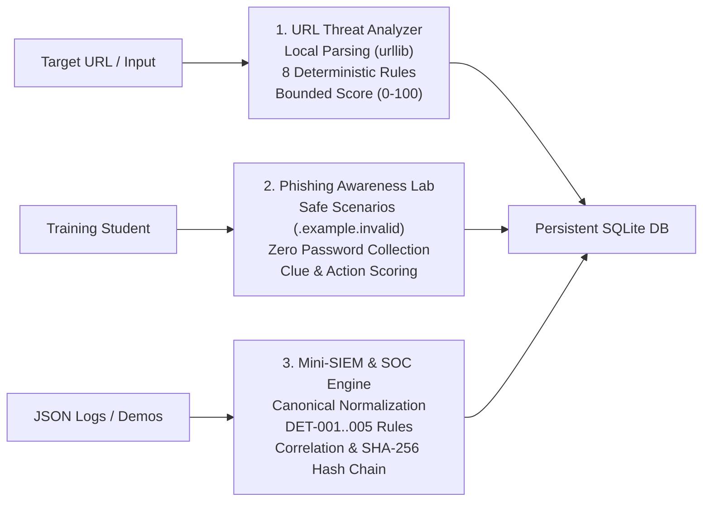

# LOGIN TWIN
### Advanced Cybersecurity Awareness, Threat Detection and Mini-SIEM Platform
**Department of Information Technology • Three-Member B.Tech Project Team**  
**Technology Stack:** Python 3 • Flask • SQLite • HTML5 • CSS3 (Dark SOC UI) • JavaScript

---

## 1. System Overview & The Three Pillars

Login Twin is an integrated cybersecurity learning and monitoring platform built strictly according to the **Login Twin Technical Blueprint & Implementation Guide**. It unifies three essential pillars:



1. **Advanced URL Threat Analyzer (FR-01 to FR-03):** Deterministic local syntax and heuristic risk analysis of submitted URLs using Python standard library `urllib.parse`. **Strict Operational Boundary:** Never opens, visits, or makes outbound HTTP requests to the target URL.
2. **Phishing Awareness and Simulation Lab (FR-04 to FR-05):** Controlled interactive educational environment using reserved RFC domains (`.example.invalid`). Trains users to spot lures, inspect headers, and choose safe actions. **Privacy & Safety Boundary:** Never accepts, collects, or stores passwords.
3. **Mini-SIEM Security Operations Center (FR-06 to FR-13):** Ingestion and canonical normalization of security event streams into UTC ISO-8601, sliding-window detection rules (DET-001 through DET-005), multi-alert event correlation engine, incident case management lifecycle, and a tamper-evident SHA-256 audit hash chain.

---

## 2. Detection Rules Matrix

| Rule ID | Rule Name | Detection Logic | Default Severity | Handled False Positives |
|---|---|---|---|---|
| **DET-001** | Brute Force Detection | For 1 account, counts failed logins within 5 min (300s). Triggers at $\ge 5$ failures. | **High** | User mistypes password; test script; shared team account. |
| **DET-002** | Password Spraying | For 1 source IP, counts distinct targeted accounts with failed logins within 10 min. Triggers at $\ge 5$ distinct accounts. | **High** | Shared corporate NAT IP; university proxy; batch IAM sync. |
| **DET-003** | Suspicious IP Activity Burst | Counts failed/denied/invalid security events from 1 source IP within 5 min. Triggers at $\ge 10$ events. | **Medium** | Authorized security vulnerability scanner; admin check. |
| **DET-004** | Repeated Unauthorized Access | Counts `access_denied` events for the same source IP/account within 5 min. Triggers at $\ge 5$ denials. | **Medium** | User lacks permissions for new role and repeatedly retries. |
| **DET-005** | Abnormal Request Activity | Counts `request_invalid` or malformed events from 1 source IP within 2 min. Triggers at $\ge 8$ requests. | **Medium** | Buggy client frontend version or malformed browser plugin. |

---

## 3. URL Threat Analyzer Rules

| Rule ID | Indicator | Logic | Points | UI Caution Note |
|---|---|---|---|---|
| **URL-001** | Non-HTTPS Protocol | Scheme is unencrypted `http://` | **+5** | HTTPS alone does not prove trustworthiness. |
| **URL-002** | IP-Literal Host | Hostname parses as raw IPv4/IPv6 address | **+20** | Some legitimate internal devices use IP hosts. |
| **URL-003** | Suspicious Keywords | Host/path contains terms: `verify`, `login`, `secure`, `account`, etc. | **+5 ea (max +15)** | Common in legitimate login flows; context sensitive. |
| **URL-004** | Excessive URL Length | Length exceeds configurable threshold (75 characters) | **+10** | Legitimate tracking or OAuth URLs can be long. |
| **URL-005** | Unusual Subdomain Depth | Host contains 4+ labels ($\ge 3$ dots) | **+10** | Enterprise CDNs may use multi-tier subdomains. |
| **URL-006** | Obfuscated Patterns | High percent-encoding ($\ge 3$ `%`) or userinfo `@` symbol | **+10** | Percent encoding is standard in parameters. |
| **URL-007** | Known URL Shortener | Matches list (`bit.ly`, `tinyurl.com`, `t.co`, etc.) | **+10** | Shorteners are widely used on social media. |
| **URL-008** | Punycode / Homograph | Contains `xn--` or non-ASCII internationalized characters | **+15** | Legitimate multilingual IDN domains exist. |

*Risk Display Bands:*
- **0–19 Low:** *"No strong indicators found by these checks"*
- **20–49 Medium:** *"Potentially suspicious – verify independently"*
- **50–74 High:** *"Potentially suspicious – verify independently"*
- **75–100 Critical:** *"Potentially suspicious – verify independently"*

---

## 4. Tamper-Evident SHA-256 Audit Hash Chain

Every critical administrative action (log ingestion, alert state change, incident transition, analyst note) is appended with cryptographic hash chaining:

$$\text{Canonical Content} = \text{ID} \parallel \text{PreviousHash} \parallel \text{Action} \parallel \text{EntityType} \parallel \text{EntityID} \parallel \text{DetailsJSON} \parallel \text{CreatedAt}$$
$$\text{EntryHash} = \text{SHA-256}(\text{Canonical Content})$$

- **Integrity Verification:** A one-click automated verification tool re-computes every block's hash sequentially. Any unauthorized modification to an existing audit record invalidates all subsequent hashes in the chain.
- **Academic Limitation Disclosure:** Tamper-evident under stated assumptions, not tamper-proof against an attacker with full root access to replace the database and codebase.

---

## 5. Project Structure

```
login_twin/
├── app.py                         # Flask application factory & error handlers
├── config.py                      # Rule thresholds, risk bands, SQLite DB path
├── requirements.txt               # Pinned dependencies
├── README.md                      # Comprehensive guide & viva preparation
├── database/
│   ├── db.py                      # SQLite connection helper & schema seed
│   ├── schema.sql                 # Canonical relational schema & indexes
│   └── repositories.py            # Parameterized database repositories
├── modules/
│   ├── url_analyzer/              # Local deterministic URL rules & scoring
│   ├── phishing_lab/              # Educational scenarios & safe grading
│   ├── soc_monitor/               # Log ingestion, normalizer & detection engine
│   ├── correlation/               # Explainable multi-alert correlation engine
│   └── incident_management/       # Incidents, alerts & audit hash chain
├── routes/
│   ├── dashboard_routes.py        # SOC metrics & charts API
│   ├── url_routes.py              # URL Analyzer routes
│   ├── phishing_routes.py         # Phishing Lab routes
│   ├── soc_routes.py              # Security Events stream & Ingestion routes
│   ├── alert_routes.py            # Alert triage & escalation routes
│   └── incident_routes.py         # Incidents, Correlation & Audit routes
├── templates/                     # Dark SOC-style Cyberpunk UI templates
├── static/                        # CSS stylesheets & JavaScript helpers
├── sample_logs/                   # Realistic sample datasets
└── tests/                         # Comprehensive unit & integration tests
```

---

## 6. How to Run the Application

### 1. Start the Flask Server:
```bash
python app.py
```
*The application initializes the SQLite database at `database/login_twin.db` and starts on `http://127.0.0.1:5000`.*

### 2. Run the Automated Test Suite:
```bash
python -m unittest discover -s tests -p "test_*.py"
```
All test cases (URL-T01..T05, PH-T01..T02, SOC-T01..T02, DET-T01..T04, COR-T01..T02, INC-T01, SEC-T01, AUD-T01) will run and pass cleanly.

---

## 7. Viva & Oral Exam Preparation (Section 15.2)

| Question | Expected Technical Answer |
|---|---|
| **Why is this a cybersecurity project?** | It integrates URL threat-indicator analysis, phishing awareness, security event monitoring, multi-rule detection, event correlation, and incident triage. |
| **What makes it advanced?** | A modular event pipeline, configurable sliding time-window rules, evidence-linked alerts, event correlation, and incident lifecycle management—not just static pages. |
| **Is the URL confirmed malicious?** | No. The score is heuristic and explainable; local syntax analysis cannot prove safety or maliciousness without context. |
| **How do you monitor logs?** | The system ingests synthetic or authorized structured logs, normalizes them into canonical UTC ISO-8601, and applies time-window rules. |
| **What is brute force vs password spraying?** | Brute force repeatedly targets one account; password spraying attempts a single or few passwords across many distinct accounts from one source IP. |
| **What is event correlation?** | Grouping related evidence by meaningful shared keys (e.g. source IP across multiple detection rules) within time windows with clear explanations. |
| **Why SQLite?** | It is serverless, lightweight, local, zero-config, and sufficient for academic demonstration; it can later be migrated to PostgreSQL. |
| **What is a false positive?** | Benign activity incorrectly flagged by a rule, such as an employee mistyping their password repeatedly. |
| **Does hash chaining prevent all tampering?** | No. It is tamper-evident (detects modifications under stated assumptions), but an attacker with complete root access could rewrite the entire database. |
| **What is the current monitoring boundary?** | Only supplied synthetic or authorized logs are processed; the app does not claim to monitor full network traffic. |
